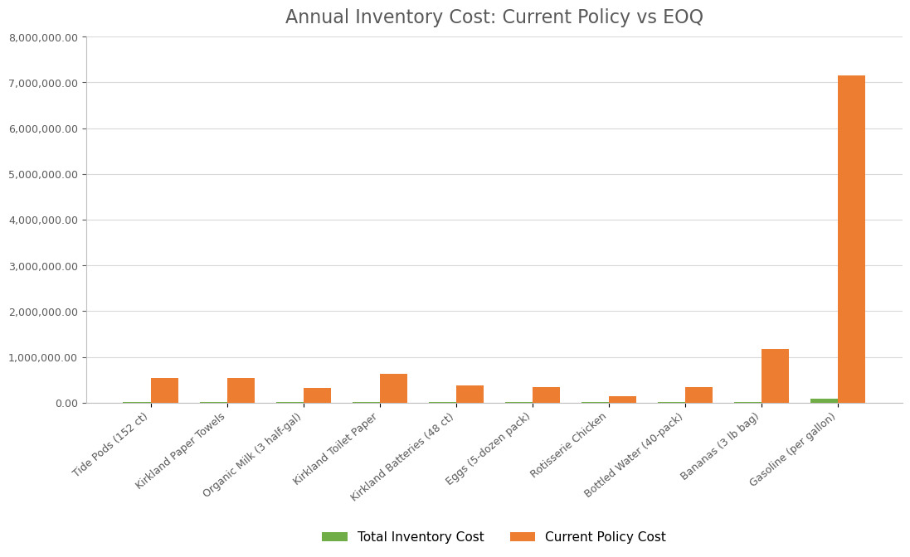
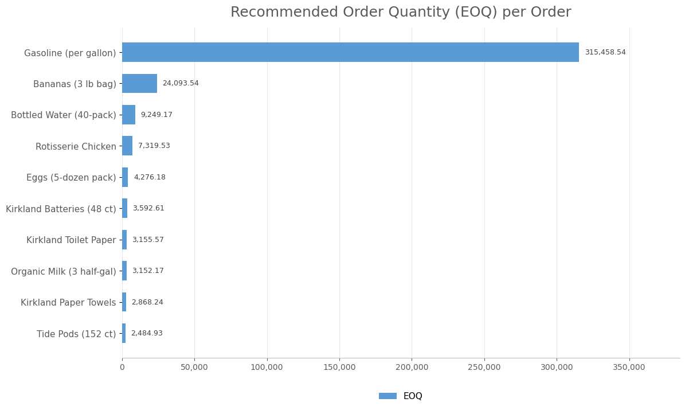

# Costco Inventory Optimization Project
### Economic Order Quantity + Safety Stock Model | Excel

EOQ model for 10 high-velocity Costco products using 2025 data.
Order quantities minimize annual ordering plus holding cost. The workbook also calculates a reorder point and safety stock for each product.

## Key Results
Figures are for one warehouse. Demand on the Data sheet is already scaled to a single warehouse. Dollar amounts match the Dashboard currency format, and percentages match a `0.00%` display of the model.

- Total annual savings vs current policy: **$11,403,317.23** per warehouse
- Average per-product cost change: **-97.37%**
  - Dashboard cell B4: the simple average of each product's EOQ cost ÷ current-policy cost − 1
  - The same products are **97.37%** lower on that simple average, which is `(current − EOQ) / current` averaged across the 10 products
- Dollar-weighted cost reduction: **98.37%**
  - `(total current-policy cost − total EOQ cost) / total current-policy cost`
- Biggest winners by dollar savings: **Gasoline, Bananas, Kirkland Toilet Paper**

| Product | Annual savings | Per-product cost change |
| --- | ---: | ---: |
| Gasoline (per gallon) | $7,078,848.29 | -98.87% |
| Bananas (3 lb bag) | $1,163,902.12 | -98.65% |
| Kirkland Toilet Paper | $612,034.35 | -97.63% |
| Kirkland Paper Towels | $534,362.07 | -97.59% |
| Tide Pods (152 ct) | $522,623.12 | -96.87% |
| Kirkland Batteries (48 ct) | $363,015.94 | -96.59% |
| Eggs (5-dozen pack) | $338,671.69 | -97.21% |
| Bottled Water (40-pack) | $330,096.55 | -97.55% |
| Organic Milk (3 half-gal) | $320,840.04 | -96.99% |
| Rotisserie Chicken | $138,923.04 | -95.72% |

## How the model is calculated
- Holding cost per unit = unit cost × (holding % ÷ 100). An entered holding % of 22.5 means 22.5%.
- EOQ inventory cost = annual ordering cost + annual cycle-stock holding cost.
- Current-policy cost is the baseline in Calculations column M: 25% of annual unit-cost purchases, plus ordering cost at a fixed lot size of 2,000 units (50,000 for bananas, 10,000 for gasoline).
- Safety stock = `1.645 × √(daily demand × lead time in days)`, using a 95% service factor and variance equal to expected demand during lead time. Reorder point = safety stock + demand during lead time. Those two columns are reported in units; they are separate from the cost comparison.

## How to Use
- Download `Costco_Inventory_Optimizer.xlsx`
- Go to the "Data" sheet → update demand or costs → everything auto-calculates
- Check the "Dashboard" sheet for the savings summary and charts

## Charts

## Data Sources
- Demand -> scaled to per warehouse
- Demand reverse-engineered from public revenue, earnings calls, and Costco prices (Dec 2025)
- Prices checked on costco.com Dec 2025
- Holding % and order costs evaluated based on industry standards

## Tools Used
- Microsoft Excel (EOQ, Safety Stock, Reorder Point)
- Charts

___________________________________________________________________________________
Built by Vennela Kottapally
Rutgers University - Supply Chain Management '29
Summer 2027 Internship Candidate
